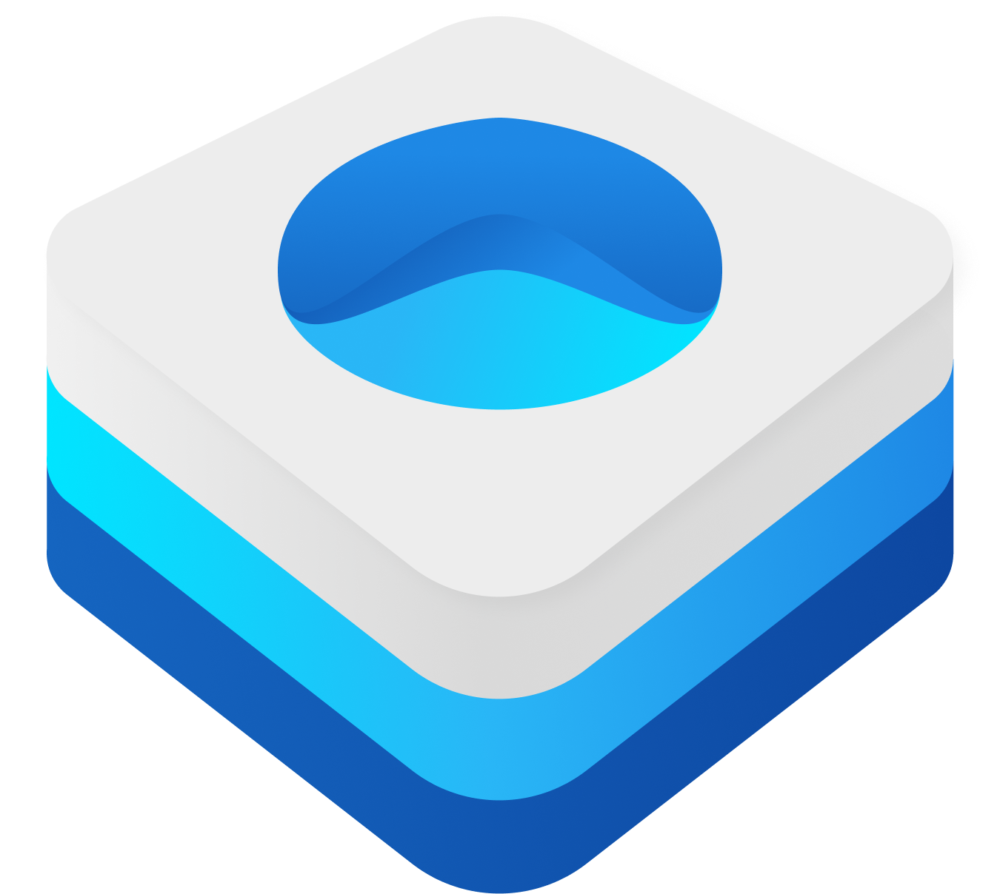

 

# Paint

Paint is a color library for Swift, with platform support for SwiftUI/UIKit/AppKit. It converts between color models, adjusts colors perceptually in OKLCH, measures contrast with WCAG 2 and APCA, and generates palettes, scales and mesh gradients. It is wide gamut and HDR aware throughout, so Display P3 and HDR colors keep their gamut and brightness. `PaintUI` adds a UIKit color picker that edits colors in any of those color spaces.


## See Also

- [Engine](https://github.com/nathantannar4/Engine)
- [Turbocharger](https://github.com/nathantannar4/Turbocharger)
- [Transmission](https://github.com/nathantannar4/Transmission)
- [Metallic](https://github.com/nathantannar4/Metallic)
- [Ignition](https://github.com/nathantannar4/Ignition)

## Requirements

- Deployment target: iOS 13.0, macOS 10.15, Mac Catalyst 13.0, tvOS 13.0, watchOS 6.0 or visionOS 1.0
- `PaintUI`: iOS 14.0, Mac Catalyst 14.0 or visionOS 1.0
- Xcode 16.4+

## Installation

### Xcode Projects

Select `File` -> `Add Package Dependencies...` and enter `https://github.com/nathantannar4/Paint`. Add the `Paint` library to your target, and `PaintUI` for the color picker.

### Swift Package Manager Projects

You can add `Paint` as a package dependency in your `Package.swift` file:

```swift
let package = Package(
    //...
    dependencies: [
        .package(url: "https://github.com/nathantannar4/Paint"),
    ],
    targets: [
        .target(
            name: "YourPackageTarget",
            dependencies: [
                .product(name: "Paint", package: "Paint"),
                // For the color picker
                .product(name: "PaintUI", package: "Paint"),
            ],
            //...
        ),
        //...
    ],
    //...
)
```

## Documentation

Detailed documentation is available [here](https://swiftpackageindex.com/nathantannar4/Paint/main/documentation/paint).

#### Introduction to Paint

For some sample code to get started with Paint, build and run the included "Example" project.

### Color Models

Every color model conforms to `ColorConvertible`, so any color converts to any other, and to `Color`, `UIColor`, `NSColor`, `CGColor` and `CIColor`.

- `RGBAColor`, `HEXColor`, `HSBAColor`, `HSLAColor`, `HWBColor` and `CMYKColor`
- `OKLCHColor` and `OKLabColor`, which are perceptually uniform
- `CIELabColor`, `CIELCHColor` and `XYZColor`
- `CSSColor`, which keeps the CSS color string it was decoded from

```swift
let orange: HEXColor = "#FF8000"
let oklch = orange.toOKLCHColor()
let color = oklch.toColor()
```

`RGBAColor` is extended sRGB. `RGBAColor(red:green:blue:colorSpace:)` and `toComponents(in:)` convert to and from the components of another `ColorSpace`, such as Display P3, linear sRGB or BT.2020, at `Double` precision and without ColorSync.

```swift
let red = RGBAColor(red: 1, green: 0, blue: 0, colorSpace: .displayP3)
let p3 = orange.toRGBAColor().toComponents(in: .displayP3)
```

### Adjustments

Adjustments are made in OKLCH, so lightening a color keeps its hue and how colorful it looks. Results are fitted to a `ColorGamut` (`.sRGB`, `.displayP3` or `.rec2020`).

```swift
let hover = accent.lightened(by: 0.1)
let muted = accent.saturated(by: -0.05)
let mix = accent.mixed(with: HEXColor("#FFFFFF"), by: 0.25)
let rotated = accent.hueRotated(by: .degrees(30))
let dark = accent.adapted(from: HEXColor("#FFFFFF"), to: HEXColor("#000000"))
```

`adapted(from:to:)` moves a color to a new background, such as for dark mode, keeping its contrast and hue. `withProminence(_:against:)` fades a color for secondary, tertiary and quaternary content, like the system label colors.

### Contrast and Accessibility

- `contrast(.wcag)` and `contrast(.apca)` measure a color with the WCAG 2 or APCA algorithm, with the same API for each
- `against(_:)` gives a `WCAGContrast`, with levels such as `.aa` and `.aaa`, or an `APCAContrast` in Lc
- `adjusted(toMinimum:against:)` changes only the lightness, as little as needed, to meet a minimum contrast
- `increased(against:by:)` raises APCA contrast, for increased contrast variants
- `luminance`, `isDark` and `isLight` measure a color by the algorithm's luminance, and pick text colors
- `preferredForeground(among:minimum:)` picks the first text color, in order of preference, that meets a minimum on a background. If none does, it picks the one with the most contrast
- `tintedForeground(minimum:)` gives text with the hue of its background, such as dark blue on a light blue badge, where black looks harsh
- `simulating(_:severity:)` and `daltonized(for:severity:)` simulate and correct for a `ColorVisionDeficiency`

```swift
let passesAA = text.contrast(.wcag).against(background).meets(.aa)
let readable = text.contrast(.apca).adjusted(toMinimum: 60, against: background)
let label = background.contrast(.apca).preferredForeground(among: [accent, white, black], minimum: 60)
let badgeText = badge.contrast(.wcag).tintedForeground(minimum: .aa)
```

`distance(to:)` and `deltaE2000(to:)` measure how different two colors look, and `nearest(to:)` and `removingNearDuplicates(threshold:)` find and remove similar colors in a collection. `minimumDistance(simulating:)` and `isDistinguishable(threshold:for:)` check that colors, such as the series of a chart, can still be told apart with protanopia, deuteranopia or tritanopia.

```swift
let isSafe = chartColors.isDistinguishable() // normal vision and each dichromacy
```

`toDescriptiveName()` describes a color in plain English, such as `"dark grayish blue"`, for VoiceOver labels and color pickers, and `formatted(.name)` writes it as a format style. `toNearestCSSNamedColor()` finds the closest CSS name, such as `steelblue`.

### Shadows and Elevation

- `shadow(opacity:)` gives a shadow for content on a background. The shadow keeps the background's hue, so it looks rich instead of gray and dirty
- `elevated(level:)` lightens dark surfaces for elevation levels `1` to `5`, as in iOS and Material dark appearances, where shadows are hard to see
- `elevated(level:tint:)` tints raised surfaces towards an accent in both appearances

```swift
Card()
    .background(surface.elevated(level: 2).toColor())
    .shadow(color: background.shadow().toColor(), radius: 12, y: 6)
```

### Palettes and Generation

- `TonalScale` generates `50` to `950` shades from a seed color, like Tailwind CSS. With `hueShift`, highlights turn warmer and shadows cooler, as painters shade, so the scale looks less flat
- `harmony(_:)` generates complementary, analogous, triadic and other `ColorHarmony` schemes
- `OKLCHColor.categorical(count:)` generates evenly spaced, distinct colors for charts
- `OKLCHColor(hashing:)` generates a stable color from a string, such as a user name
- `ColorScale` maps numbers to colors for heat maps and legends: `sequential(_:domain:)` for low to high values, and `diverging(from:to:domain:midpoint:)` for values on either side of a midpoint. Lightness changes evenly, so the order is still clear in grayscale or with color blindness
- `sorted(by:)` sorts colors by `.hue`, `.lightness`, `.chroma` or `.stepped`, which groups hues into slices and alternates light to dark and dark to light between them, for swatch grids
- `ColorGradient` interpolates in any CSS color space, such as Oklab, OKLCH, LCh (HCL) or HSL, with an optional easing curve, and adds just enough stops to look the same in SwiftUI, Core Animation and Core Graphics, which each blend differently

```swift
let blue = TonalScale(seed: HEXColor("#3B82F6"))
let background = blue[50]
let text = blue[900]

let warm = TonalScale(seed: HEXColor("#22C55E"), hueShift: .degrees(12))

let triad = accent.harmony(.triadic)

let heat = ColorScale.sequential(HEXColor("#E4572E"), domain: 0...100)
let cell = heat(42)
let change = ColorScale.diverging(from: HEXColor("#2563EB"), to: HEXColor("#EA580C"), domain: -20...100, midpoint: 0)

let swatches = palette.sorted(by: .stepped)

let gradient = ColorGradient(colors: [HEXColor("#0033FF"), HEXColor("#FFE600")], in: .oklch)
let shade = ColorGradient(from: HEXColor("#000000"), to: RGBAColor(red: 0, green: 0, blue: 0, alpha: 0), curve: .easeInOut)
LinearGradient(gradient: gradient.toGradient(), startPoint: .leading, endPoint: .trailing)
gradientLayer.setGradient(gradient) // CAGradientLayer
```

### Gradients, Meshes and Grain

- `ColorGradient.subtle(_:)` turns one color into a gentle gradient for buttons, cards and icons: lighter and warmer at one end, darker and cooler at the other, with the color itself in the middle
- `ColorMesh` is a grid of colors for SwiftUI's `MeshGradient`. `MeshGradient` blends in sRGB or its own perceptual space, so `toMeshGradient()` adds points in between, with colors interpolated in Oklab, OKLCH or any other `ColorInterpolationSpace`. `ColorMesh.ambient(colors:)`, `ambient(around:)` and `ColorMesh(swatches:)` generate organic backdrops, such as behind album art. The same seed always gives the same mesh
- `ColorGradient.toCGImage(width:height:)` renders a gradient into an 8-bit image with dithering, which removes the banding of subtle gradients on OLED displays
- `GrainTexture` is a tileable film grain texture to overlay on flat fills

```swift
let mesh = ColorMesh.ambient(colors: [HEXColor("#FF5E3A"), HEXColor("#FF9500"), HEXColor("#5856D6")], width: 3, height: 3)
mesh.toMeshGradient() // iOS 18, macOS 15

let image = ColorGradient(colors: [HEXColor("#1A1A1A"), HEXColor("#262626")]).toCGImage(width: 390, height: 844)

background.overlay(
    GrainTexture().toImage()?
        .resizable(resizingMode: .tile)
        .blendMode(.overlay)
        .opacity(0.08)
)
```

### Images

`ImageColorPalette` finds the background color of an image and text colors that read on it. `ImageColorSwatches` finds vibrant and muted swatches. Both are available on `CGImage`, `UIImage`, `NSImage` and image files, with `async` variants that always run off the main actor, and Combine publishers. Images at a file URL are decoded at the scaled size, so the full image is never loaded into memory.

```swift
let palette = await image.toColorPalette(quality: .low)
let swatches = await image.toColorSwatches(quality: .low)
let fromFile = await ImageColorPalette(contentsOf: url, quality: .low)

image.toColorPalettePublisher(quality: .low)
    .receive(on: DispatchQueue.main)
    .sink { palette in ... }
```

### CSS

`CSSColor` is a color written as a CSS color string. It decodes CSS Color 4 syntax, such as `#RRGGBB`, named colors, `rgb()`, `hsl()`, `oklch()` and `color(display-p3 ...)`, and keeps the string exactly as written. `toCSSColor(_:)` writes any color in a `CSSColorFormat`.

```swift
let accent = CSSColor(decoding: "oklch(0.7 0.15 250)")
let named: CSSColor = "rebeccapurple"
let hsl = HEXColor("#FF8000").toCSSColor(.hsl) // "hsl(30.118 100% 50%)"
```

### HDR and Color Temperature

- `contentHeadroom` and `isHDR` measure how much brighter than SDR white a color is, and `toStandardDynamicRange()` gives an SDR fallback
- On iOS 26, macOS 26 and later, `Color`, `UIColor`, `NSColor` and `CGColor` created from an HDR color are tagged with its headroom, so the system tone maps it for the display
- `RGBAColor(kelvin:)` creates the color of white light at a temperature, and `toCorrelatedColorTemperature()` estimates the temperature of a color

### Formatting

`formatted(_:)` writes any color with a `ColorFormatStyle`, which also parses HEX and CSS color strings. The `.name` style writes the color's `toDescriptiveName()`, for display only, so names don't parse back.

```swift
HEXColor("#FF8000").formatted(.hex)       // "FF8000"
HEXColor("#FF8000").formatted(.css(.hsl)) // "hsl(30.118 100% 50%)"
HEXColor("#2F3A4F").formatted(.name)      // "dark grayish blue"
```

### Blending and Color Matrices

- `blended(over:mode:)` blends colors with any `ColorBlendMode` from the W3C Compositing spec
- `ColorTransform` is a color matrix, with filters such as `.grayscale()`, `.sepia()`, `.saturation(_:)` and `.hueRotation(_:)`, that converts with `toSwiftUI()` for the SwiftUI `_colorMatrix(_:)` modifier

### SwiftUI, UIKit and AppKit

`ColorStyle` is a `ShapeStyle` for any color, with a color for each color scheme and contrast. `UIColor(light:dark:)` and `NSColor(light:dark:)` create dynamic colors in the same way.

```swift
Rectangle()
    .fill(ColorStyle(light: accent, dark: accent.adapted(from: HEXColor("#FFFFFF"), to: HEXColor("#000000"))))
```

`Color.transformed(_:)` returns a `ShapeStyle` that resolves system and adaptive colors in the current environment before transforming them. The transform follows the color scheme, contrast and tint.

```swift
Text("Pressed")
    .foregroundStyle(Color.accentColor.transformed { $0.darkened(by: 0.1) })
```

`ColorStyle` and `Color.transformed(_:)` require iOS 17, macOS 14, tvOS 17 or watchOS 10.

## PaintUI

`ColorPickerViewController` is a color picker in the style of `UIColorPickerViewController`, for iOS 14, Mac Catalyst 14 and visionOS. It has pages for a grid of swatches, a spectrum wheel of colors or of white light by temperature, and RGB or perceptual sliders. Every page edits colors in a `ColorSpace`, such as Display P3, and colors are reported as extended sRGB `RGBAColor`s, so they keep their wide gamut. `ColorPickerLabel` shows a color like the well of `UIColorWell`.

```swift
let picker = ColorPickerViewController(color: HEXColor("#0A84FF"))
picker.delegate = self
present(UINavigationController(rootViewController: picker), animated: true)

func colorPickerViewController(
    _ viewController: ColorPickerViewController,
    didSelect color: RGBAColor,
    continuously: Bool
) {
    view.backgroundColor = color.toUIColor()
}
```

## License

Distributed under the BSD 2-Clause License. See ``LICENSE.md`` for more information.
